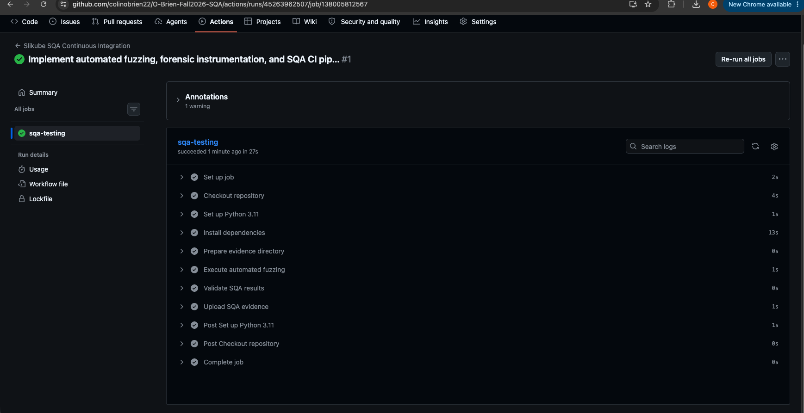
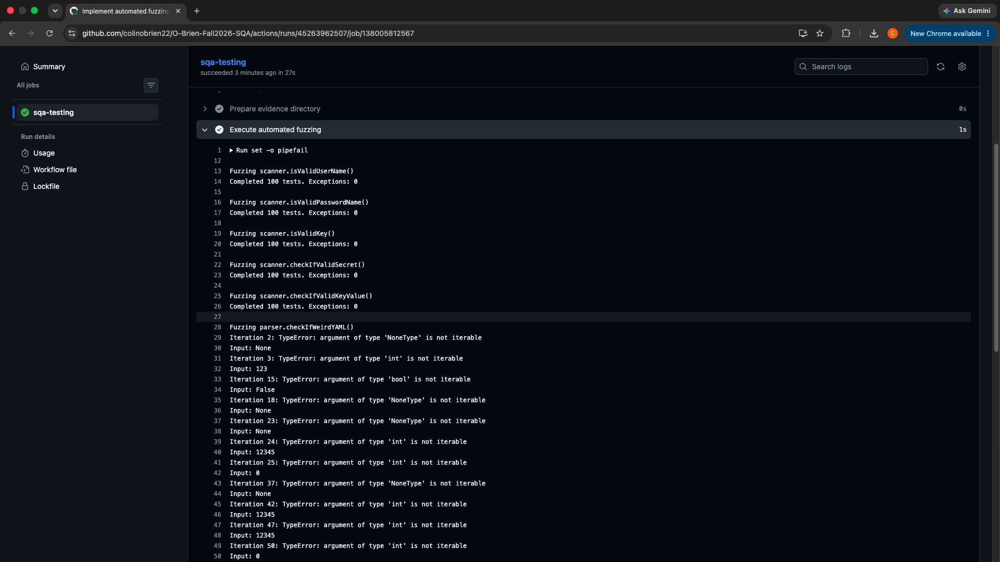
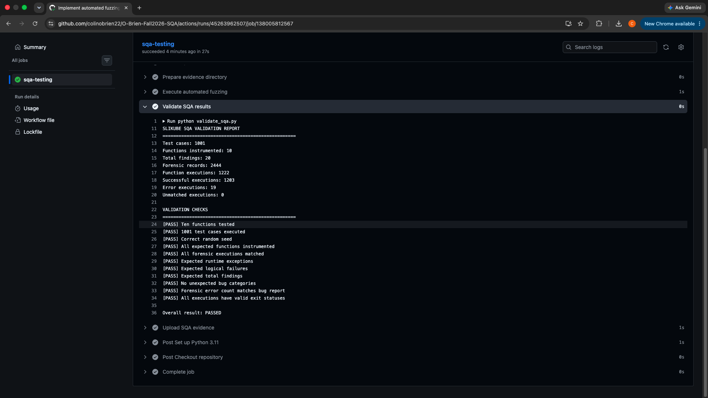
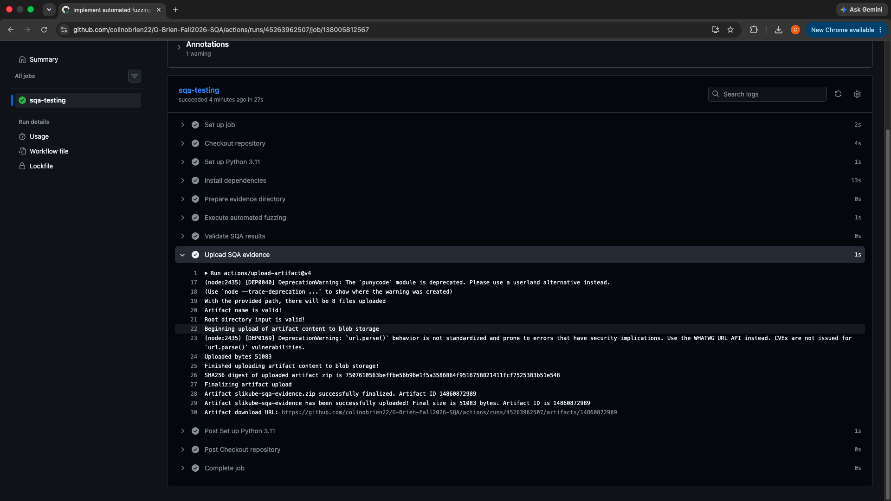
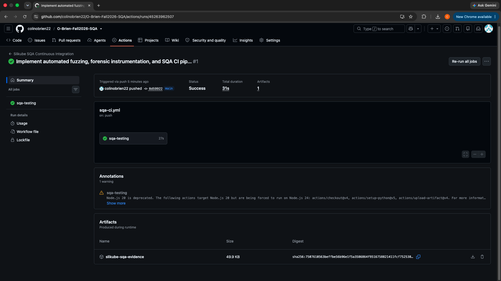

# Slikube Software Quality Assurance Project

**Course:** COMP 6710 – Software Quality Assurance  
**Semester:** Fall 2026  
**Team Name:** O-Brien  
**Team Member:** Colin O'Brien  
**Repository:** [O-Brien-Fall2026-SQA](https://github.com/colinobrien22/O-Brien-Fall2026-SQA)

---

## 1. Project Overview

The objective of this project was to integrate software quality assurance activities into Slikube, an existing Python application designed to analyze Kubernetes configuration files for security-related issues.

The project focused on three primary software quality assurance activities: automated software fuzzing, forensic instrumentation, and continuous integration. These activities were implemented to identify software defects, improve execution traceability, and establish a reproducible automated testing process.

The original application was extended without intentionally changing its functional behavior. A dedicated fuzzing framework, reusable forensic instrumentation module, automated validation script, and GitHub Actions workflow were developed to accomplish the project objectives.

## 2. Task Completion Status

The following table summarizes the implementation status of the project requirements.

| Activity | Weight | Status |
|---|---:|---|
| Unpack the provided Slikube project | 1% | Complete |
| Register team information | 1% | Pending confirmation |
| Create GitHub repository using the required naming convention | 1% | Complete |
| Create README.md containing team information | 2% | Pending final review |
| Implement automated fuzzing of 10 Python methods | 25% | Complete |
| Integrate forensic instrumentation into 10 Python methods | 25% | Complete |
| Integrate continuous integration using GitHub Actions | 25% | Complete |
| Document project activities and lessons learned | 20% | Completed in this report |

All three primary technical activities were implemented and successfully tested. The automated fuzzing framework, forensic instrumentation, and continuous integration pipeline produced reproducible results in both the local development environment and GitHub Actions.

## 3. Identification of Implementation

### 3.1 Development Environment

The project was developed using GitHub Codespaces, providing a Linux-based development environment integrated with the GitHub repository.

| Component | Configuration |
|---|---|
| Development environment | GitHub Codespaces |
| Operating system | Linux |
| Programming language | Python |
| Python version | 3.11.18 in development |
| Version control | Git |
| Repository hosting | GitHub |
| Continuous integration | GitHub Actions |
| CI runner | Ubuntu |
| Dependency management | uv and pip |
| Fuzzing random seed | 6710 |
| Forensic evidence format | JSON Lines (JSONL) |
| Bug reporting format | JSON |

A dedicated Python virtual environment was created to isolate the project dependencies. The original dependency file contained packages that presented compatibility issues, so a separate `requirements-sqa.txt` file was created containing the dependencies required by the SQA implementation.

Dependency versions were pinned to improve reproducibility between the development environment and the GitHub Actions runner.

### 3.2 Implementation Files

The primary files created or modified during this project are listed below.

| File | Description |
|---|---|
| [fuzz.py](fuzz.py) | Automated fuzzing framework and bug reporting |
| [forensics.py](forensics.py) | Reusable forensic instrumentation decorator |
| [validate_sqa.py](validate_sqa.py) | Automated validation of fuzzing and forensic evidence |
| [parser.py](parser.py) | Original parser module with five instrumented methods |
| [scanner.py](scanner.py) | Original scanner module with five instrumented methods |
| [requirements-sqa.txt](requirements-sqa.txt) | Pinned Python dependencies |
| [.github/workflows/sqa-ci.yml](.github/workflows/sqa-ci.yml) | Automated SQA continuous integration workflow |
| [.gitignore](.gitignore) | Repository exclusions for temporary files, environments, and flagged test fixtures |
| [evidence/](evidence/) | Experimental results, forensic records, and screenshots |
| [README.md](README.md) | Project and team information |
| [SQA-REPO.md](SQA-REPO.md) | Final project report |

The primary technical implementation was committed to the repository under commit [8d59922](https://github.com/colinobrien22/O-Brien-Fall2026-SQA/commit/8d59922).

### 3.3 Selected Python Methods

Ten Python methods were selected from the existing `parser.py` and `scanner.py` modules.

The same ten methods were used for automated fuzzing and forensic instrumentation, allowing the execution of the fuzzing framework to directly generate forensic evidence.

| No. | Module | Method | Purpose |
|---:|---|---|---|
| 1 | parser.py | checkIfWeirdYAML | Identify excluded or unusual YAML paths |
| 2 | parser.py | keyMiner | Recursively locate values in structured data |
| 3 | parser.py | getKeyRecursively | Extract keys and their nesting depths |
| 4 | parser.py | getValuesRecursively | Recursively extract values |
| 5 | parser.py | getValsFromKey | Retrieve values associated with a target key |
| 6 | scanner.py | isValidUserName | Validate username-related inputs |
| 7 | scanner.py | isValidPasswordName | Validate password-related inputs |
| 8 | scanner.py | isValidKey | Identify recognized key names |
| 9 | scanner.py | checkIfValidSecret | Evaluate potential secret values |
| 10 | scanner.py | checkIfValidKeyValue | Evaluate potential key values |

These methods were selected because they perform input validation, recursive data processing, and security-related configuration analysis. Such operations benefit from testing with unexpected input types, boundary conditions, and nested data structures.

## 4. Automated Software Fuzzing

### 4.1 Fuzzing Methodology

The automated fuzzing framework was implemented in `fuzz.py`.

The framework uses knowledge of the selected methods to generate appropriate test inputs while introducing randomized and unexpected values. This combines randomized fuzzing, structured input testing, edge-case testing, and targeted logical verification.

The following input categories were used:

- Random alphanumeric strings.
- Strings containing punctuation and special characters.
- Empty strings and whitespace.
- Extremely long strings.
- Positive and negative integers.
- Boolean values.
- None values.
- Empty dictionaries and lists.
- Nested dictionaries.
- Nested lists.
- Dictionaries containing username and password fields.
- Dictionaries containing mixed key types.

Each of the ten selected methods received 100 automated test cases. An additional targeted logical test was implemented to verify the recursive depth calculation performed by `getKeyRecursively()`.

This resulted in a total of 1,001 test cases.

### 4.2 Reproducibility

A fixed random seed was used to make the randomized test generation reproducible.

```python
random.seed(6710)
```

Using a fixed seed allows the same sequence of generated inputs to be reproduced across repeated executions, assuming a compatible execution environment.

This was particularly useful when comparing the original fuzzing results against the results obtained after forensic instrumentation was introduced.

### 4.3 Exception Handling and Bug Reporting

Each fuzzing operation was executed using exception handling so that an unexpected exception in one test case would not terminate the entire fuzzing process.

The framework records information about discovered failures, including:

- Finding identifier.
- Timestamp.
- Target method.
- Test iteration.
- Input value and input type.
- Exception type.
- Exception message.
- Stack trace.

The resulting findings are automatically written to:

[evidence/bug_reports.json](evidence/bug_reports.json)

This machine-readable report allows failures to be examined individually and supports automated validation during continuous integration.

The reported input values are generated test data rather than credentials collected from real Kubernetes deployments.

### 4.4 Fuzzing Results

The following results were obtained after executing the automated fuzzing framework.

| Method | Automated tests | Runtime exceptions | Logical failures |
|---|---:|---:|---:|
| scanner.isValidUserName | 100 | 0 | 0 |
| scanner.isValidPasswordName | 100 | 0 | 0 |
| scanner.isValidKey | 100 | 0 | 0 |
| scanner.checkIfValidSecret | 100 | 0 | 0 |
| scanner.checkIfValidKeyValue | 100 | 0 | 0 |
| parser.checkIfWeirdYAML | 100 | 19 | 0 |
| parser.keyMiner | 100 | 0 | 0 |
| parser.getKeyRecursively | 101 | 0 | 1 |
| parser.getValuesRecursively | 100 | 0 | 0 |
| parser.getValsFromKey | 100 | 0 | 0 |
| **Total** | **1,001** | **19** | **1** |

The automated testing process identified 20 failure occurrences representing two underlying issues: a potential input-validation robustness issue and a recursive depth calculation defect.

The absence of exceptions in the remaining methods does not establish that those methods are defect-free.

### 4.5 Discovered Issue 1: Insufficient Input Validation

**Affected method:** `parser.checkIfWeirdYAML()`

**Classification:** Potential input-validation robustness defect.

**Occurrences:** 19.

The `checkIfWeirdYAML()` method checks whether an input contains any of the values defined in `constants.WEIRD_PATHS`.

The relevant original implementation is:

```python
def checkIfWeirdYAML(yaml_script):
    val = False

    if any(x_ in yaml_script
           for x_ in constants.WEIRD_PATHS):
        val = True

    return val
```

The implementation assumes that the supplied input supports membership testing.

During automated fuzzing, non-iterable values caused the method to raise `TypeError` exceptions.

Example inputs included:

| Input | Exception |
|---|---|
| None | TypeError: argument of type 'NoneType' is not iterable |
| 123 | TypeError: argument of type 'int' is not iterable |
| 0 | TypeError: argument of type 'int' is not iterable |
| False | TypeError: argument of type 'bool' is not iterable |
| True | TypeError: argument of type 'bool' is not iterable |

The 19 exception occurrences consisted of:

| Input type | Occurrences |
|---|---:|
| NoneType | 8 |
| Integer | 9 |
| Boolean | 2 |
| **Total** | **19** |

#### Root Cause

The method performs a membership operation without first validating the supplied input type.

#### Potential Impact

If unexpected input reaches this method during normal application execution, the resulting exception could interrupt configuration processing unless it is handled by the calling code.

However, if the intended method contract strictly requires a string, these exceptions may represent invalid caller behavior rather than an independent application defect. The finding is therefore classified as a potential robustness issue.

#### Recommended Improvement

Validate the input type before performing membership operations and define the intended behavior for unsupported input types.

The original implementation was preserved so that the observed behavior could be reproduced during subsequent fuzzing and forensic analysis.

### 4.6 Discovered Issue 2: Incorrect Recursive Depth Calculation

**Affected method:** `parser.getKeyRecursively()`

**Classification:** Logical software defect.

**Occurrences:** One targeted logical test failure.

Unlike the previous finding, this defect was identified using valid structured input.

The following dictionary was supplied to the method:

```python
test_input = {
    "a": {"x": 1},
    "b": {"y": 2},
    "c": 3
}
```

The expected result was:

```python
[
    ("a", 0),
    ("x", 1),
    ("b", 0),
    ("y", 1),
    ("c", 0)
]
```

The actual result was:

```python
[
    ("a", 0),
    ("x", 1),
    ("b", 1),
    ("y", 2),
    ("c", 2)
]
```

The keys `a`, `b`, and `c` are located at the same nesting level. However, the method incorrectly assigned increasing depths to subsequent sibling keys.

#### Root Cause

The original implementation increments the local depth variable before making a recursive call.

```python
depth_ += 1
getKeyRecursively(val_, list2hold, depth_)
```

Because the incremented value remains in the current function invocation, subsequent sibling keys inherit an incorrect depth.

#### Recommended Improvement

Pass the incremented depth directly to the recursive call without modifying the current invocation's depth variable.

```python
getKeyRecursively(
    val_,
    list2hold,
    depth_ + 1
)
```

The same principle should be applied to the recursive processing of dictionary elements contained within lists.

#### Potential Impact

Incorrect nesting information could affect subsequent processing that depends on the structural relationships between configuration keys.

This finding demonstrates that exception-based fuzzing alone is insufficient for identifying every software defect. A method may execute successfully while returning or producing incorrect results.

The defect was intentionally preserved and documented because the assignment focuses on identifying and reporting defects rather than requiring their correction.

## 5. Forensic Instrumentation

### 5.1 Instrumentation Design

Forensic instrumentation was implemented using a reusable Python decorator defined in `forensics.py`.

Instead of duplicating logging code throughout the original application, the decorator provides a centralized mechanism for recording method execution.

The decorator was applied to the ten selected methods in `parser.py` and `scanner.py`.

For example:

```python
from forensics import forensic

@forensic
def checkIfWeirdYAML(yaml_script):
    ...
```

This approach reduces code duplication and separates forensic evidence collection from the original application logic.

The implementation also supports generator functions, which was necessary for instrumenting `getValuesRecursively()`.

### 5.2 Forensic Evidence Collection

The forensic instrumentation records the following information.

| Field | Purpose |
|---|---|
| execution_id | Uniquely identifies an individual function execution |
| function | Identifies the executed Python method |
| timestamp | Records the event time in UTC |
| event | Identifies an ENTRY or EXIT event |
| input_types | Records positional argument types |
| keyword_input_types | Records keyword argument types |
| status | Identifies the execution outcome |
| duration_ms | Records elapsed execution time |
| exception_type | Identifies an exception when one occurs |

Each execution generates an entry event and a corresponding exit event.

A unique execution identifier allows the two events to be correlated, including during recursive method execution.

Forensic evidence is stored in:

[evidence/forensic_logs.jsonl](evidence/forensic_logs.jsonl)

JSON Lines was selected because each event is independently machine-readable and can be processed sequentially by automated analysis tools.

### 5.3 Example Forensic Records

The following records demonstrate a successful execution of `scanner.isValidUserName()` during the initial instrumentation test.

**Entry event:**

```json
{
  "execution_id": "8084465e-d765-454a-bd5f-d10cd1f80ec7",
  "function": "scanner.isValidUserName",
  "input_types": ["str"],
  "keyword_input_types": {},
  "event": "ENTRY",
  "timestamp": "2026-11-23T20:39:11.382624+00:00"
}
```

**Exit event:**

```json
{
  "execution_id": "8084465e-d765-454a-bd5f-d10cd1f80ec7",
  "function": "scanner.isValidUserName",
  "input_types": ["str"],
  "keyword_input_types": {},
  "event": "EXIT",
  "status": "SUCCESS",
  "duration_ms": 0.0095,
  "timestamp": "2026-11-23T20:39:11.383222+00:00"
}
```

The matching execution identifiers establish the relationship between the entry and exit events.

### 5.4 Security Considerations

Because Slikube processes security-related configuration information, forensic logging must avoid unnecessarily exposing sensitive values.

The instrumentation records input types rather than raw argument values. This provides information about execution behavior while reducing the possibility of exposing passwords, credentials, or configuration secrets through forensic logs.

Exceptions are recorded and propagated rather than silently suppressed by the instrumentation.

### 5.5 Forensic Execution Results

The following forensic evidence was generated during the instrumented fuzzing execution.

| Metric | Result |
|---|---:|
| Instrumented methods | 10 |
| Total forensic records | 2,444 |
| Entry events | 1,222 |
| Exit events | 1,222 |
| Successful executions | 1,203 |
| Error executions | 19 |
| Unmatched executions | 0 |

The number of function executions exceeded the number of fuzzing test cases because recursive methods generated additional instrumented calls.

The individual method execution counts were:

| Method | Executions |
|---|---:|
| parser.checkIfWeirdYAML | 100 |
| parser.getKeyRecursively | 119 |
| parser.getValsFromKey | 125 |
| parser.getValuesRecursively | 189 |
| parser.keyMiner | 189 |
| scanner.checkIfValidKeyValue | 100 |
| scanner.checkIfValidSecret | 100 |
| scanner.isValidKey | 100 |
| scanner.isValidPasswordName | 100 |
| scanner.isValidUserName | 100 |
| **Total** | **1,222** |

All recorded executions had matching entry and exit events.

The 19 error executions corresponded to the runtime exceptions identified by the fuzzing framework. The logical defect was detected separately by the test harness because the affected method completed without raising an exception.

### 5.6 Comparison Before and After Instrumentation

| Metric | Before instrumentation | After instrumentation |
|---|---:|---:|
| Methods tested | 10 | 10 |
| Test cases | 1,001 | 1,001 |
| Runtime exceptions | 19 | 19 |
| Logical failures | 1 | 1 |
| Forensic records | 0 | 2,444 |

The matching results provide evidence that the forensic instrumentation preserved the observed functional behavior for the selected test cases.

This comparison does not establish complete behavioral equivalence for every possible application input.

## 6. Continuous Integration with GitHub Actions

### 6.1 Workflow Implementation

A dedicated GitHub Actions workflow was created at:

[.github/workflows/sqa-ci.yml](.github/workflows/sqa-ci.yml)

The original application workflow was preserved, and a separate workflow was introduced specifically for the SQA activities.

The SQA workflow is configured to execute automatically when:

- Changes are pushed to the `main` branch.
- Pull requests target the `main` branch.
- A user manually dispatches the workflow.

The workflow executes the following sequence:

1. Check out the GitHub repository.
2. Configure Python 3.11.
3. Install the pinned project dependencies.
4. Prepare the forensic evidence directory.
5. Execute the automated fuzzing framework.
6. Validate the generated bug reports and forensic evidence.
7. Upload the evidence as a downloadable workflow artifact.

The artifact upload step is configured to execute even if a preceding workflow step fails, allowing available evidence to be retained for investigation.

### 6.2 Automated Validation

The `validate_sqa.py` script was implemented to automatically evaluate the generated evidence.

The validation script performs the following eleven checks:

| Validation check | Result |
|---|---|
| Ten functions tested | PASS |
| 1,001 test cases executed | PASS |
| Correct random seed | PASS |
| All expected functions instrumented | PASS |
| All forensic executions matched | PASS |
| Expected runtime exceptions | PASS |
| Expected logical failures | PASS |
| Expected total findings | PASS |
| No unexpected bug categories | PASS |
| Forensic error count matches bug report | PASS |
| All executions have valid exit statuses | PASS |

The validation script returns a nonzero exit status if any validation check fails, causing the corresponding GitHub Actions step to fail.

The current validation process uses the established experimental findings as a regression baseline.

A successful validation result does not indicate that the original application is defect-free. Instead, it indicates that the recorded findings and forensic evidence are consistent with the established baseline.

If the known defects are corrected in the future, the expected validation results must be updated accordingly.

### 6.3 Continuous Integration Results

The first SQA workflow execution successfully completed following the push of commit `8d59922`.

| Metric | Result |
|---|---|
| Workflow name | Slikube SQA Continuous Integration |
| Workflow run | 1 |
| Branch | main |
| Trigger | Git push |
| Overall status | Success |
| Total workflow duration | 31 seconds |
| Testing job duration | 27 seconds |
| Fuzzing test cases | 1,001 |
| Validation checks passed | 11 of 11 |
| Forensic records | 2,444 |
| Uploaded evidence files | 8 |
| Evidence artifact | slikube-sqa-evidence |
| Artifact size | 49.9 KB |

The successful workflow execution is available at:

[GitHub Actions Workflow Run](https://github.com/colinobrien22/O-Brien-Fall2026-SQA/actions/runs/45263962507)

### 6.4 Supporting Screenshots

#### Figure 1. Successful GitHub Actions Workflow

The following screenshot demonstrates successful completion of the automated SQA workflow and its individual execution steps.



#### Figure 2. Automated Fuzzing Execution

The following screenshot demonstrates the automatic execution of the fuzzing framework and the detection of runtime exceptions.



#### Figure 3. Automated SQA Validation

The following screenshot demonstrates the successful validation of all eleven SQA checks, including forensic evidence completeness and expected findings.



#### Figure 4. Evidence Artifact Upload

The following screenshot demonstrates the successful upload of the generated SQA evidence.



#### Figure 5. Continuous Integration Summary

The following screenshot demonstrates the overall successful workflow execution and the downloadable evidence artifact.



## 7. Instructions to Replicate the Work

The following instructions describe how to reproduce the software quality assurance activities implemented during this project.

### 7.1 Clone the Repository

```bash
git clone https://github.com/colinobrien22/O-Brien-Fall2026-SQA.git

cd O-Brien-Fall2026-SQA
```

### 7.2 Configure the Python Environment

Python 3.11 is recommended.

Create a virtual environment:

```bash
python3.11 -m venv .venv
```

Activate the virtual environment on Linux or macOS:

```bash
source .venv/bin/activate
```

On Windows PowerShell:

```powershell
.venv\Scripts\Activate.ps1
```

Verify the Python version:

```bash
python --version
```

### 7.3 Install Dependencies

```bash
python -m pip install --upgrade pip
python -m pip install -r requirements-sqa.txt
```

Verify that the required application modules can be imported:

```bash
python -c "import parser, scanner, graphtaint; print('Imports successful')"
```

### 7.4 Execute Automated Fuzzing

Prepare a clean forensic log before executing the fuzzer.

```bash
python -c "from pathlib import Path; p = Path('evidence/forensic_logs.jsonl'); p.parent.mkdir(exist_ok=True); p.write_text('')"
```

Execute the fuzzing framework:

```bash
python fuzz.py
```

To additionally capture the terminal output on Linux or macOS:

```bash
python fuzz.py | tee evidence/reproduced_fuzz_results.txt
```

When using the second command instead of the first, clear the forensic log beforehand. Repeated executions without clearing the log will append additional forensic records.

The fuzzing framework automatically generates:

```text
evidence/bug_reports.json
evidence/forensic_logs.jsonl
```

The expected results are:

- 10 methods tested.
- 1,001 test cases executed.
- 19 runtime exception occurrences.
- One logical failure.
- 20 total reported findings.

### 7.5 Validate the Generated Evidence

Execute the automated validation script:

```bash
python validate_sqa.py
```

The expected final output is:

```text
Overall result: PASSED
```

The validation script also generates:

```text
evidence/sqa_validation.txt
```

### 7.6 Examine Forensic Evidence

The forensic records can be inspected using:

```bash
head -4 evidence/forensic_logs.jsonl
```

The number of generated forensic records can be determined using:

```bash
wc -l evidence/forensic_logs.jsonl
```

Error events can be counted using:

```bash
grep '"status": "ERROR"' evidence/forensic_logs.jsonl | wc -l
```

For a clean execution using the established baseline, the expected results are 2,444 forensic records and 19 error events.

### 7.7 Execute GitHub Actions

The continuous integration workflow can be reproduced by pushing changes to the `main` branch of a repository containing the implementation.

Alternatively:

1. Open the repository on GitHub.
2. Select the Actions tab.
3. Select Slikube SQA Continuous Integration.
4. Select Run workflow.
5. Choose the `main` branch.
6. Start the workflow.
7. Review the `sqa-testing` job.
8. Download the `slikube-sqa-evidence` artifact from the workflow summary.

Manual execution requires appropriate repository permissions. A user without write access can reproduce the workflow using a fork with GitHub Actions enabled.

## 8. Experimental Evidence

The repository contains the following supporting evidence.

| Evidence file | Description |
|---|---|
| [baseline_fuzz_results.txt](evidence/baseline_fuzz_results.txt) | Initial automated fuzzing results |
| [enhanced_fuzz_results.txt](evidence/enhanced_fuzz_results.txt) | Fuzzing results including targeted logical verification |
| [instrumented_fuzz_results.txt](evidence/instrumented_fuzz_results.txt) | Fuzzing results after forensic instrumentation |
| [bug_reports.json](evidence/bug_reports.json) | Machine-readable findings and stack traces |
| [forensic_logs.jsonl](evidence/forensic_logs.jsonl) | Machine-readable forensic execution records |
| [forensic_summary.txt](evidence/forensic_summary.txt) | Summary of forensic execution results |
| [sqa_validation.txt](evidence/sqa_validation.txt) | Automated validation results |
| [screenshots/](evidence/screenshots/) | Visual evidence of successful continuous integration |

These files provide evidence of the implementation and execution of automated fuzzing, forensic instrumentation, and continuous integration.

## 9. Challenges and Limitations

### 9.1 Dependency Compatibility

The original application included a dependency configuration containing packages that were incompatible with the available Python environment.

A separate Python 3.11 virtual environment and dedicated dependency file were created to resolve these compatibility issues.

The required dependencies were subsequently pinned to improve reproducibility.

### 9.2 Repository Secret Scanning

During the initial repository upload, GitHub secret-scanning protection identified potential credentials in two existing YAML test fixtures:

```text
TEST_ARTIFACTS/helm.stackgres.yaml
TEST_ARTIFACTS/helm.values.yaml
```

These files were removed from Git tracking and added to `.gitignore` rather than bypassing the security protection.

This prevented the flagged fixtures from being included in the subsequent repository upload.

The exclusion of these fixtures may affect original application tests that depend on them, but the implemented SQA workflow successfully executed without them.

### 9.3 Recursive and Generator Instrumentation

Several selected methods use recursion, and one selected method uses generator-based execution.

The forensic decorator was designed to support both ordinary functions and generator functions. Unique execution identifiers were used to distinguish recursive invocations and associate their entry and exit events.

### 9.4 GitHub Actions Dependency Warning

The successful GitHub Actions workflow generated a warning concerning the deprecation of Node.js 20 used by several workflow actions.

GitHub executed the affected actions using Node.js 24, and the workflow completed successfully.

Future maintenance should include reviewing and updating workflow action versions to maintain compatibility with the GitHub Actions execution environment.

### 9.5 Testing Limitations

The fuzzing framework evaluates ten selected methods rather than the entire application.

The fixed random seed improves reproducibility but limits the diversity of inputs generated across repeated executions.

The current framework primarily detects runtime exceptions, with one additional targeted logical correctness test. Other logical defects may remain undetected.

The automated validation checks confirm consistency with the established findings rather than proving the absence of defects.

Forensic logging also introduces execution overhead and depends on the availability of a writable evidence directory. The project did not perform a separate quantitative analysis of instrumentation overhead.

Future improvements could include additional random seeds, code coverage measurement, property-based testing, coverage-guided fuzzing, more comprehensive logical assertions, and improved forensic logging resilience.

## 10. Lessons Learned

Through this project, I learned that automated fuzzing can expose unexpected input-handling failures and that logical assertions are necessary to identify defects that do not generate runtime exceptions. I also learned that forensic instrumentation provides valuable execution traceability by recording correlated events, timestamps, and execution outcomes while minimizing unnecessary exposure of sensitive information. Finally, I learned that integrating reproducible testing and automated evidence validation into a continuous integration pipeline improves software quality assurance by making testing consistent, repeatable, and easier to investigate.

## 11. Conclusion

This project successfully integrated automated software fuzzing, forensic instrumentation, and continuous integration into the existing Slikube Python application.

The automated fuzzing framework executed 1,001 test cases across ten selected methods and identified 19 runtime exception occurrences and one logical failure. These findings demonstrated the importance of both input robustness testing and explicit verification of expected application behavior.

The forensic instrumentation generated 2,444 machine-readable records representing 1,222 function executions, with no unmatched entry or exit events. The automated validation framework confirmed the consistency of the recorded findings and forensic evidence.

The GitHub Actions workflow successfully reproduced the experimental results, passed all eleven validation checks, and uploaded the supporting evidence.

The completed technical implementation demonstrates how software quality assurance activities can be integrated into an existing application to improve defect discovery, execution traceability, reproducibility, and automated testing.
